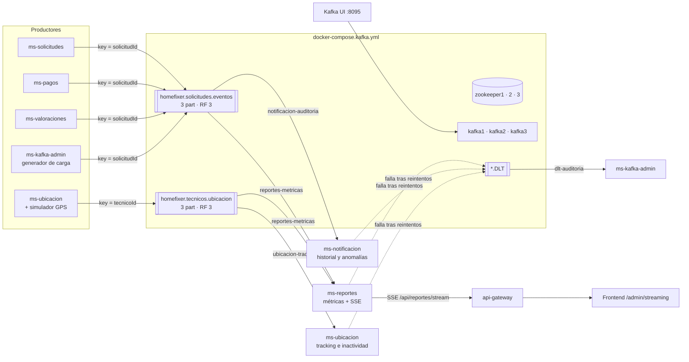

# HomeFixer — Streaming de eventos con Apache Kafka

Kafka **complementa** a RabbitMQ sin reemplazarlo:

| | RabbitMQ (ver `MENSAJERIA.md`) | Kafka (este documento) |
|---|---|---|
| Rol | Workflow transaccional: cobro al completar, PAGADA al pagar, RPC, notificaciones al usuario | Stream de eventos de negocio: métricas en tiempo real, auditoría, tracking GPS, replay |
| Modelo | Cola: el mensaje se borra con el ACK | Log distribuido: los eventos se **retienen** y se pueden releer |
| Orden | Por cola | Por partición (key = `solicitudId` / `tecnicoId`) |
| Escala | Competing consumers | Particiones + consumer groups |

Cada hecho de negocio se publica **en ambos brokers con el mismo `eventoId`**. Si Kafka cae, el negocio sigue (RabbitMQ), y queda `[ALERTA][KAFKA]` en el log. Con `KAFKA_ENABLED=false` un servicio deja de usar Kafka sin otros cambios.

---

## 1. Arquitectura



### Tolerancia a fallos

- **3 Zookeeper en quórum:** coordinan la elección del controller y la metadata del clúster. Con 2 de 3 nodos arriba hay mayoría y el clúster sigue operando.
- **3 brokers:** cada partición tiene un líder y 2 seguidores repartidos en los 3 brokers. Si cae un broker, un seguidor del ISR toma el liderazgo; `unclean.leader.election.enable=false` impide elegir réplicas desactualizadas.
- **`acks=all` + `min.insync.replicas=2`:** una escritura se confirma cuando está en 2 réplicas. Con 1 broker caído se sigue escribiendo; con 2 caídos se rechaza la escritura (consistencia antes que disponibilidad).

```bash
docker compose -f docker-compose.kafka.yml up -d       # 3 ZK + 3 brokers + creación de tópicos
docker compose -f docker-compose.kafka-ui.yml up -d    # Kafka UI → http://localhost:8095
docker compose -f docker-compose.kafka.yml logs kafka-init
```

En la nube: `KAFKA_HOST=<IP o DNS de la VM>` al levantar el compose, y `KAFKA_BOOTSTRAP=<host>:9092,<host>:9093,<host>:9094` en los microservicios.

---

## 2. Tópicos

Creados por `kafka/create-topics.sh` (contenedor `kafka-init`) y declarados también como beans `NewTopic` en `ms-kafka-admin` (`KafkaAdminConfig`), así el despliegue es replicable.

| Tópico | Part. | RF | cleanup.policy | retention.ms | Otros | Justificación |
|---|:-:|:-:|---|---|---|---|
| `homefixer.solicitudes.eventos` | 3 | 3 | `delete` | 7 días | `min.insync.replicas=2`, `lz4` | Historia de negocio que no se puede perder y se relee (auditoría, reconstruir métricas) |
| `homefixer.tecnicos.ubicacion` | 3 | 3 | `compact,delete` | 24 h | `segment.ms=1h`, `min.cleanable.dirty.ratio=0.1` | Flujo continuo de alta frecuencia: basta la última posición por técnico |
| `*.DLT` (uno por tópico) | 3 | 3 | `delete` | 14 días | `min.insync.replicas=2` | Mensajes fallidos para análisis; misma partición que el original |

- **3 particiones:** hasta 3 consumidores en paralelo por grupo, y un líder por broker (la carga queda repartida).
- **Key por entidad:** todos los eventos de una solicitud (o de un técnico) caen en la misma partición y se consumen en orden.
- `auto.create.topics.enable=false`: nadie crea tópicos por accidente con una configuración por defecto.

---

## 3. Diseño de eventos (`shared/.../kafka`)

**`SolicitudEventoKafka`** (key = `solicitudId`)

| Campo | Para qué |
|---|---|
| `eventoId` | Idempotencia: los consumidores descartan duplicados (reintentos, re-envíos) |
| `tipo` | `SOLICITUD_CREADA`, `TECNICO_ASIGNADO`, `ESTADO_ACTUALIZADO`, `PAGO_PROCESADO`, `VALORACION_REGISTRADA` |
| `version` | Evolución del esquema sin romper consumidores |
| `ocurridoEn` | Momento del hecho (ISO-8601), base de las ventanas de tiempo |
| `origen` | Microservicio productor (trazabilidad) |
| `solicitudId`, `clienteId`, `tecnicoId` | Entidades involucradas |
| `categoria` | Solicitudes por categoría |
| `estadoAnterior`, `estadoNuevo` | Solicitudes por estado, validación de transiciones |
| `monto` | Ingresos en tiempo real |
| `calificacion` | Satisfacción en vivo |

**`UbicacionTecnicoEvento`** (key = `tecnicoId`): `eventoId`, `tecnicoId`, `latitud`, `longitud`, `enLinea`, `solicitudEnCursoId` (ocupado/libre), `registradoEn`, `origen`.

Ambos tienen `validar()`; un evento inválido lanza `EventoInvalidoException` (no reintentable → DLT).

---

## 4. Productores

| Servicio | Tópico | Cuándo |
|---|---|---|
| ms-solicitudes | solicitudes.eventos | Crear, asignar técnico, llegada, inicio, término, cancelación |
| ms-pagos | solicitudes.eventos | Pago procesado (estado `PAGADA`) |
| ms-valoraciones | solicitudes.eventos | Valoración registrada (promedio del técnico) |
| ms-ubicacion | tecnicos.ubicacion | Cada `PUT /api/ubicacion/tecnicos/{id}` y cada desconexión |
| ms-ubicacion (`KAFKA_SIMULADOR=true`) | tecnicos.ubicacion | 5 técnicos ficticios (9001-9005) moviéndose por Santiago cada 2 s |
| ms-kafka-admin | solicitudes.eventos | `POST /simular?eventos=N`: ciclos de vida completos para la demo de lag |

`KafkaEventPublisher` (shared) y la configuración del cliente en cada `application.yml`:

```yaml
spring.kafka:
  bootstrap-servers: ${KAFKA_BOOTSTRAP:localhost:9092,localhost:9093,localhost:9094}
  producer:
    key-serializer: StringSerializer
    value-serializer: JsonSerializer        # + spring.json.type.mapping (tokens cortos de tipo)
    acks: all
    retries: 10
    compression-type: lz4
    properties:
      enable.idempotence: true              # sin duplicados por reintentos del productor
      linger.ms: 10                         # micro-batching
      max.block.ms: 3000                    # si Kafka no responde, no colgar la petición HTTP
```

El log muestra a qué partición y offset llegó cada evento: `[KAFKA][PUBLISH] homefixer.solicitudes.eventos SOLICITUD_CREADA key=101 -> partition=2 offset=0`.

---

## 5. Consumidores y consumer groups

| Grupo | Servicio | Tópicos | Qué hace | Endpoint |
|---|---|---|---|---|
| `reportes-metricas` | ms-reportes | ambos | Métricas en tiempo real | `GET /api/reportes/metricas/tiempo-real`, SSE `/api/reportes/stream` |
| `notificacion-auditoria` | ms-notificacion | solicitudes.eventos | Historial por solicitud y transiciones inválidas (`[ALERTA][AUDITORIA]`) | `GET /api/notificaciones/kafka/auditoria[/solicitudes/{id}]` |
| `ubicacion-tracking` | ms-ubicacion | tecnicos.ubicacion | Distancia, velocidad e inactividad (`[ALERTA][TRACKING]`) | `GET /api/ubicacion/tracking/tecnicos[/{id}]` |
| `dlt-auditoria` | ms-kafka-admin | *.DLT | Registro de mensajes fallidos (`[DLT]`) | `GET /api/kafka/admin/dlt` |

- **Entre grupos (pub/sub):** reportes y notificación leen el mismo tópico con offsets propios; los dos reciben todos los eventos.
- **Dentro de un grupo (balanceo):** `concurrency: 3` = un hilo por partición. Con una segunda instancia de ms-reportes, Kafka reparte las 3 particiones entre ambas; si una cae, la otra las toma (`CooperativeStickyAssignor` rebalancea sin detener a todos).
- **Separación de capas:** el `@KafkaListener` solo valida y delega en un servicio de dominio sin dependencias de Kafka (`MetricasStreamingService`, `AuditoriaEventosService`, `TrackingTecnicosService`).
- Commit manual (`enable-auto-commit: false`, `ack-mode: record`): el offset avanza solo después de procesar.

---

## 6. Manejo de errores (`KafkaErrorHandling`)

1. **JSON corrupto:** `ErrorHandlingDeserializer` evita el bucle de "poison pill"; va directo al DLT con los bytes originales.
2. **Payload inválido:** `validar()` lanza `EventoInvalidoException`, no reintentable, y va al DLT.
3. **Error transitorio:** 3 reintentos con backoff exponencial (1 s, 2 s, 4 s), registrados como `[KAFKA][RETRY]`, y después DLT.
4. **DLT:** el mensaje se publica en `<topic>.DLT` en la misma partición, con los headers `kafka_dlt-exception-*` y `kafka_dlt-original-*`, y se hace commit: la partición no se bloquea.
5. **Duplicados:** se descartan por `eventoId` (`[KAFKA][DUPLICADO]`).

Verificado: un evento sin `solicitudId` y un mensaje `esto-no-es-json` terminaron en `homefixer.solicitudes.eventos.DLT`, y el consumidor siguió con lag 0.

---

## 7. Administración: `ms-kafka-admin` (puerto 8091)

Por el gateway, en `/api/kafka/admin/**`, solo para **ROLE_ADMIN**. Swagger: "Kafka Admin".

| Método | Ruta | Operación |
|---|---|---|
| GET | `/cluster` | Brokers y controller |
| GET | `/topics[?internos=true]` | Lista (particiones, RF, protegido, sub-replicado) |
| GET | `/topics/{t}[?todasLasConfigs=true]` | Líder, réplicas, ISR, offsets y mensajes por partición, y configs |
| POST | `/topics` | Crear `{nombre, particiones, replicas, configs}` |
| GET / PUT | `/topics/{t}/config` | Ver / modificar `{set:{...}, eliminar:[...]}` (lista blanca de 13 claves validadas) |
| POST | `/topics/{t}/partitions` | Ampliar `{total}` (Kafka no permite reducir) |
| DELETE | `/topics/{t}[?forzar=true]` | Eliminar (los 4 tópicos del caso están protegidos; los internos nunca) |
| GET | `/consumer-groups` | Grupos y estado |
| GET | `/consumer-groups/{g}` | Miembros, asignación, assignor, **lag por partición y por tópico** |
| POST | `/consumer-groups/{g}/reset-offsets` | `EARLIEST` (replay), `LATEST`, `OFFSET`, `TIMESTAMP`; exige el grupo sin consumidores |
| DELETE | `/consumer-groups/{g}` | Eliminar grupo |
| GET | `/dlt[?topico=&limite=]` | Últimos mensajes fallidos con origen y causa |
| POST | `/simular?eventos=N` | Generador de carga para la demo |

Errores: 409 si existe / está protegido / el grupo tiene consumidores, 404 si no existe, 400 si la configuración o los datos son inválidos, 503 si Kafka no responde.

Equivalentes por CLI:

```bash
docker exec kafka1 kafka-topics --bootstrap-server kafka1:29092 --describe --topic homefixer.solicitudes.eventos
docker exec kafka1 kafka-configs --bootstrap-server kafka1:29092 --entity-type topics --entity-name homefixer.solicitudes.eventos --describe
docker exec kafka1 kafka-consumer-groups --bootstrap-server kafka1:29092 --describe --group reportes-metricas
docker exec kafka1 kafka-consumer-groups --bootstrap-server kafka1:29092 --group reportes-metricas --reset-offsets --to-earliest --all-topics --execute
```

---

## 8. Supervisión: offsets, lag y distribución

- **Lag** = offset final de la partición − offset comprometido por el grupo. Un lag que crece de forma sostenida indica consumidores lentos o caídos: hay que escalar instancias (hasta 3, una por partición) o revisar errores.
- **Distribución:** en Kafka UI (Consumers → grupo) o en `GET /consumer-groups/{g}` se ve qué consumidor tiene cada partición.
- **Sub-replicación:** `subReplicado=true` / ISR menor que las réplicas indica un broker caído o atrasado.

---

## 9. Guion de demo (EP6)

1. **Arquitectura:** `docker compose ps` (3 ZK + 3 brokers + UI). En Kafka UI → Brokers.
2. **Tópicos 3×3:** Kafka UI → Topics → `homefixer.solicitudes.eventos` → Partitions (un líder distinto por broker).
3. **Flujo completo:** crear una solicitud en el front → log `[KAFKA][PUBLISH] ... partition=X offset=Y` → mensaje en Kafka UI (Messages, filtrar por key) → `[KAFKA][CONSUME]` en ms-reportes → `/admin/streaming` se actualiza.
4. **Tiempo real:** ms-ubicacion con `KAFKA_SIMULADOR=true` → los técnicos se mueven en el mapa de `/admin/streaming`.
5. **Tolerancia a fallos:** `docker stop kafka2` → ISR baja a 2 en Kafka UI, se sigue produciendo → `docker start kafka2` → vuelve al ISR.
6. **Lag:** detener ms-reportes → `POST /api/kafka/admin/simular?eventos=3000` → el lag sube → levantar 2 instancias de ms-reportes (`--server.port=8092` en la segunda) → particiones repartidas y el lag baja a 0.
7. **Administración:** crear un tópico, cambiar `retention.ms`, ampliar particiones, reset `EARLIEST` de un grupo detenido (replay).
8. **Errores:** Kafka UI → Produce Message con `{"tipo":"SOLICITUD_CREADA"}` → `[KAFKA][DLT]` en el log y el mensaje en `GET /api/kafka/admin/dlt`.
