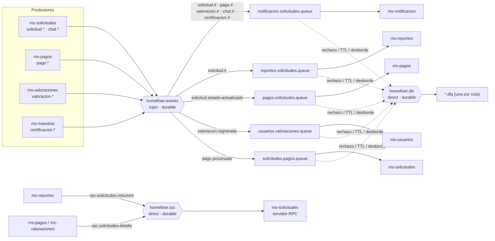

# HomeFixer — Mensajería entre microservicios

Este documento describe cómo HomeFixer implementa cada requisito de mensajería: mensajes síncronos y asíncronos, ACK, durabilidad, Publish/Subscribe, Dead Letter Exchange, políticas de retención y alertas. Para cada uno se indica el código que lo implementa y cómo demostrarlo.

El broker es **RabbitMQ 3.13** (con consola de administración), levantado con `docker-compose.yml`. La topología es común a todos los servicios y está en el módulo `shared`:

| Archivo | Responsabilidad |
|---|---|
| `shared/.../messaging/MessagingConstants.java` | Exchanges, colas, routing keys y valores de retención |
| `shared/.../messaging/EventQueues.java` | Declara cada cola de suscriptor con su DLQ, TTL y límite de largo |
| `shared/.../messaging/EventPublisher.java` | Publicador de eventos con mensajes persistentes, publisher confirms y returns |
| `rabbitmq/rabbitmq.conf` | Alarmas de memoria y disco, y `consumer_timeout` |

---

## 1. Topología general



---

## 2. Mensajes síncronos

En HomeFixer hay dos mecanismos síncronos: RPC sobre RabbitMQ y llamadas HTTP con OpenFeign.

### 2.1 Request/Reply sobre RabbitMQ (RPC)

El cliente envía la petición al exchange `homefixer.rpc` y **se queda bloqueado esperando la respuesta**. Usa `convertSendAndReceive`, con cola de respuesta `reply_to` y `correlation_id`.

| Cliente | Routing key | Cola | Servidor | Para qué |
|---|---|---|---|---|
| ms-reportes | `rpc.solicitudes.resumen` | `solicitudes.rpc.resumen.queue` | ms-solicitudes | Resumen de solicitudes por estado para el dashboard |
| ms-pagos | `rpc.solicitudes.detalle` | `solicitudes.rpc.detalle.queue` | ms-solicitudes | Datos de la solicitud para generar el cobro |
| ms-valoraciones | `rpc.solicitudes.detalle` | `solicitudes.rpc.detalle.queue` | ms-solicitudes | Verificar que la solicitud esté `PAGADA` antes de valorar |

- **Servidores:** `ms-solicitudes/.../listener/ResumenSolicitudesRpcListener.java` y `DetalleSolicitudRpcListener.java`. El método `@RabbitListener` retorna el DTO y Spring lo envía a la cola indicada en `reply_to`.
- **Clientes:** `ms-reportes/.../service/SolicitudesRpcClient.java`, `ms-pagos/.../client/SolicitudesRpcClient.java` y `ms-valoraciones/.../service/ValoracionService.java`.
- **Timeout:** `spring.rabbitmq.template.reply-timeout: 5000`. Si no llega respuesta en 5 s, el cliente registra `[ALERTA][RPC]` en el log y responde **503** al front.

### 2.2 HTTP síncrono con OpenFeign y Eureka

| Origen → Destino | Llamada | Uso |
|---|---|---|
| ms-solicitudes → ms-ubicacion | `buscarTecnicosCercanos` | Técnicos cercanos a notificar al crear una solicitud |
| ms-solicitudes → ms-usuarios | `obtenerTecnico` | Validar la especialidad del técnico al asignarlo |
| ms-ubicacion → ms-usuarios | `GET /api/tecnicos/lote` | Datos de los técnicos en línea |
| ms-ubicacion → ms-maestria | `GET /api/maestria/insignias/lote` | Insignias de maestría para ordenar la búsqueda |
| ms-usuarios → ms-solicitudes | `contarSolicitudesActivas` | Impedir que un técnico renuncie con trabajos activos |
| ms-maestria → ms-usuarios | `GET /api/usuarios/me`, `GET /api/tecnicos/{id}` | Verificar que quien llama es admin o técnico, y su nivel de reputación |

---

## 3. Mensajes asíncronos

El productor publica el evento y **sigue sin esperar** a los consumidores. Cada evento es un `NotificacionEventDTO` (`shared/.../dto/NotificacionEventDTO.java`) con `eventoId` único, fecha, ids involucrados y destinatarios.

| Evento (routing key) | Productor | Cuándo | Consumidores |
|---|---|---|---|
| `solicitud.creada` | ms-solicitudes | El cliente crea una solicitud | notificación, reportes |
| `solicitud.tecnico-asignado` | ms-solicitudes | Se asigna un técnico | notificación, reportes |
| `solicitud.estado-actualizado` | ms-solicitudes | Llegada del técnico, inicio, término o cancelación | notificación, reportes, **pagos** (genera el cobro al completarse) |
| `chat.mensaje` | ms-solicitudes | Mensaje en el chat del servicio | notificación |
| `pago.procesado` | ms-pagos | El cliente paga | notificación, **solicitudes** (COMPLETADA → PAGADA) |
| `valoracion.registrada` | ms-valoraciones | Se registra una valoración | notificación, **usuarios** (recalcula promedio y nivel) |
| `certificacion.aprobada` / `certificacion.rechazada` | ms-maestria | Un admin revisa una certificación | notificación |

### Ejemplo: cierre de un servicio, completamente asíncrono

```
Técnico "Finalizar" → ms-solicitudes (COMPLETADA) ──solicitud.estado-actualizado──► ms-pagos genera el cobro
Cliente paga        → ms-pagos (PROCESADO)        ──pago.procesado──────────────► ms-solicitudes pasa a PAGADA
Cliente valora      → ms-valoraciones             ──valoracion.registrada───────► ms-usuarios recalcula reputación
Admin aprueba cert. → ms-maestria                 ──certificacion.aprobada──────► ms-notificacion avisa al técnico
```

---

## 4. ACK respectivos

### 4.1 ACK del broker al productor (publisher confirms y returns)

Está en `EventPublisher.rabbitTemplate(...)` y se activa en el `application.yml` de cada productor (ms-solicitudes, ms-pagos, ms-valoraciones y ms-maestria):

```yaml
spring.rabbitmq:
  publisher-confirm-type: correlated   # el broker confirma (ACK) o rechaza (NACK) cada mensaje
  publisher-returns: true              # devuelve los mensajes que no llegaron a ninguna cola
```

- Cada mensaje viaja con un `CorrelationData(eventoId)`, y `ConfirmCallback` registra `[CONFIRM] Broker confirmó (ACK) el evento …`. Si el broker responde NACK, registra `[ALERTA][CONFIRM]`.
- `setMandatory(true)` junto con `ReturnsCallback`: un mensaje que no se pudo enrutar a ninguna cola queda registrado como `[ALERTA][RETURN] Mensaje no enrutable …`.

### 4.2 ACK del consumidor (ACK manual)

```yaml
spring.rabbitmq.listener.simple:
  acknowledge-mode: manual        # el consumidor confirma explícitamente cada mensaje
  prefetch: 10                    # máximo 10 mensajes sin confirmar por consumidor
  default-requeue-rejected: false # un rechazo nunca vuelve a la cola: va al DLX
```

| Consumidor | Archivo | Comportamiento |
|---|---|---|
| ms-notificacion | `listener/NotificacionEventListener.java` | **3 reintentos con espera creciente** (500 ms, 1000 ms). Si funciona, `basicAck`; si los 3 fallan, `basicNack(requeue=false)` y el mensaje va a la DLQ |
| ms-reportes | `listener/SolicitudEventListener.java` | `basicAck` / `basicNack(requeue=false)` |
| ms-pagos | `listener/CobroSolicitudListener.java` | `basicAck` / `basicNack(requeue=false)` |
| ms-usuarios | `listener/ValoracionEventListener.java` | `basicAck` / `basicNack(requeue=false)` |
| ms-solicitudes | `listener/PagoProcesadoListener.java` | `ackMode = "MANUAL"` en el listener. Las colas RPC del mismo servicio siguen con ACK automático |

Además, `rabbitmq.conf` define `consumer_timeout = 1800000`: si un consumidor no confirma un mensaje en 30 minutos, el broker cierra su canal y vuelve a entregar el mensaje.

### 4.3 Idempotencia frente a reentregas

Un ACK manual puede producir reentregas, así que los consumidores toleran recibir el mismo mensaje dos veces:
- **ms-notificacion:** restricción única `(eventoId, usuarioId)` en la tabla `notificaciones`, más una verificación previa.
- **ms-pagos:** `generarCobro` no crea un segundo cobro si la solicitud ya tiene uno.
- **ms-solicitudes:** `marcarPagada` no hace nada si la solicitud ya está `PAGADA`.

---

## 5. Durabilidad

| Nivel | Cómo |
|---|---|
| Exchanges | `ExchangeBuilder…durable(true)` para `homefixer.events`, `homefixer.dlx` y `homefixer.rpc` |
| Colas | `QueueBuilder.durable(...)` para todas las colas principales, DLQ y RPC |
| Mensajes | `MessageDeliveryMode.PERSISTENT` en `EventPublisher.publicar`: el broker los escribe a disco |
| Datos del broker | Volumen Docker `rabbitmq-data:/var/lib/rabbitmq` con `hostname` fijo (el nombre del nodo no cambia entre reinicios) |
| Fallo del broker al publicar | `EventPublisher` captura `AmqpException` y registra `[ALERTA]`. La operación de negocio no se revierte |

**Demostración:** con un consumidor detenido, publica eventos y luego ejecuta `docker compose restart rabbitmq`. Los mensajes siguen en la cola al volver.

---

## 6. Publish / Subscribe

- El exchange **topic** `homefixer.events` entrega una copia del evento a **cada cola suscrita** cuya routing key coincida.
- Cada microservicio consumidor declara **su propia cola**, con `EventQueues.suscriptor(cola, dlq, routingKeys…)`. Así, un mismo evento lo procesan varios servicios de forma independiente, cada uno a su ritmo.
- **Ejemplo:** un `solicitud.estado-actualizado` con estado `COMPLETADA` llega a la vez a:
  - `notificacion.solicitudes.queue`: avisa al cliente que puede pagar.
  - `reportes.solicitudes.queue`: suma la métrica del evento.
  - `pagos.solicitudes.queue`: genera el cobro pendiente.
- Los patrones topic (`solicitud.#`, `pago.#`, …) permiten agregar nuevos tipos de evento sin tocar a los suscriptores.

---

## 7. DLX / DLQ (Dead Letter)

Cada cola principal se declara con estos argumentos (`EventQueues.suscriptor`):

```java
QueueBuilder.durable(cola)
    .deadLetterExchange("homefixer.dlx")      // x-dead-letter-exchange
    .deadLetterRoutingKey(dlq)                // x-dead-letter-routing-key
    .ttl(24 h)                                // x-message-ttl
    .maxLength(10_000)                        // x-max-length
    .withArgument("x-overflow", "reject-publish-dlx")
```

Un mensaje termina en su DLQ por cualquiera de estas causas:
1. **Rechazo:** el consumidor responde `basicNack(requeue=false)` después de fallar.
2. **Expiración:** pasaron 24 h sin que nadie lo consumiera.
3. **Desborde:** la cola alcanzó los 10.000 mensajes.

| Cola principal | DLQ |
|---|---|
| `notificacion.solicitudes.queue` | `notificacion.solicitudes.dlq` |
| `reportes.solicitudes.queue` | `reportes.solicitudes.dlq` |
| `pagos.solicitudes.queue` | `pagos.solicitudes.dlq` |
| `usuarios.valoraciones.queue` | `usuarios.valoraciones.dlq` |
| `solicitudes.pagos.queue` | `solicitudes.pagos.dlq` |

**Demostración:**
1. Envía un mensaje de chat, o crea una solicitud, cuyo texto contenga `FORZAR_ERROR`.
2. ms-notificacion simula una falla del proveedor: hace 3 intentos y luego el NACK.
3. El mensaje aparece en `notificacion.solicitudes.dlq` en la consola `http://localhost:15672/#/queues`.
4. Ahí también se ven los headers `x-death`, con el motivo y la cola de origen.

---

## 8. Políticas de retención

Los valores están definidos en `MessagingConstants`:

| Cola | TTL (`x-message-ttl`) | Largo máximo (`x-max-length`) | Al exceder |
|---|---|---|---|
| Principales de eventos | **24 horas** | **10.000** mensajes | Se envían a la DLQ (`reject-publish-dlx`) |
| DLQ | **7 días** (análisis y reprocesamiento) | **50.000** mensajes | Se descartan los más antiguos |
| RPC | **10 segundos** | — | Se descartan sin DLQ: una petición vencida ya no la espera nadie |

---

## 9. Alertas

| Origen | Condición | Cómo se ve |
|---|---|---|
| **`ColasMonitor`** (ms-notificacion, cada 60 s) | Una DLQ tiene mensajes (umbral `umbral-dlq: 1`) | `[ALERTA][DLQ] <dlq> contiene N mensajes fallidos` |
| | Una cola principal acumula 1.000 mensajes o más (consumidor lento) | `[ALERTA] La cola … acumula N mensajes` |
| | Una cola principal no tiene consumidores (servicio caído) | `[ALERTA] La cola … no tiene consumidores conectados` |
| | No se puede consultar RabbitMQ | `[ALERTA] No se pudo consultar RabbitMQ` |
| **Endpoint** | Estado de todas las colas y sus DLQ | `GET /api/notificaciones/mensajeria/colas` (mensajes y consumidores por cola) |
| **Publisher confirms** | NACK del broker o mensaje no enrutable | `[ALERTA][CONFIRM]` · `[ALERTA][RETURN]` |
| **RPC** | Sin respuesta en 5 s | `[ALERTA][RPC]` y respuesta 503 |
| **Broker** (`rabbitmq.conf`) | RAM sobre el 60 % (`vm_memory_high_watermark.relative = 0.6`) o menos de 1 GB de disco libre (`disk_free_limit.absolute = 1GB`) | RabbitMQ bloquea a los productores en vez de caerse, y muestra la alarma en la consola |

Los umbrales se configuran en `ms-notificacion/src/main/resources/application.yml`, bajo `homefixer.messaging.alertas`.

**Demostración:** detén ms-pagos y, en menos de un minuto, ms-notificacion registra `La cola pagos.solicitudes.queue no tiene consumidores conectados`.

---

## 10. Cómo verificarlo en vivo

1. `start-all.bat`: cierra procesos previos, instala `shared`, levanta RabbitMQ (con healthcheck) y los microservicios.
2. Abre la consola de RabbitMQ en `http://localhost:15672` (guest / guest).
   - **Exchanges:** deben aparecer `homefixer.events` (topic), `homefixer.dlx` y `homefixer.rpc`, los tres con la marca **D** de durable.
   - **Queues:** cada cola debe mostrar las marcas **D**, **TTL**, **Lim**, **DLX** y **DLK**.
3. Recorre un flujo completo: crear solicitud → asignar técnico → llegada → iniciar → finalizar → pagar → valorar. En el log de cada servicio aparecen las líneas `[CONFIRM]` y `[ACK]` de cada paso.
4. Prueba la DLQ con `FORZAR_ERROR` (sección 7) y las alertas deteniendo un consumidor (sección 9).
5. Prueba el RPC con `GET /api/reportes/solicitudes/resumen` (ms-reportes ↔ ms-solicitudes).

---

## 11. Alcance y limitaciones conocidas

- **Publicación sin outbox:** el evento se publica dentro de la transacción de negocio. Si el broker está caído, el evento se pierde (queda la alerta en el log).
- **Reintentos solo en ms-notificacion:** los demás consumidores envían el mensaje a la DLQ al primer fallo.
- **Reprocesamiento manual de la DLQ:** se hace desde la consola de RabbitMQ (*Move messages*). No hay un endpoint automático.
- **Alertas solo en log y endpoint:** no se integró correo ni Slack.
- **Un solo nodo:** RabbitMQ corre en un nodo con colas clásicas. Para producción se usarían colas *quorum* en un clúster.
