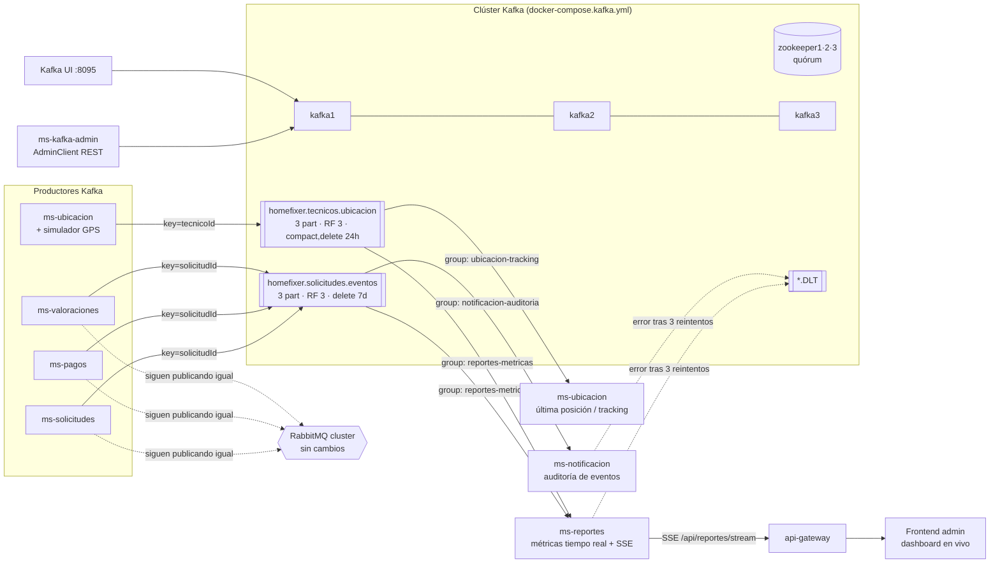

# HomeFixer · Entrega 3: plan de implementación Apache Kafka (EP5 + EP6)

> Objetivo: obtener el 100 % en **EP5 (encargo, código, 12 %)** y **EP6 (presentación, 18 %)**, y cubrir la **Nota 3** ("Streaming de datos con Apache Kafka": topic del caso, productor y consumidor, flujo continuo visible).
> Fechas: 003V → 19 y 21 nov · 002V → 23 nov (sin prórroga).

---

## 0. Análisis: ¿Kafka sirve en HomeFixer? Sí, y no reemplaza a RabbitMQ

La pauta lo dice textualmente: *"cómo Kafka complementa la arquitectura existente **sin afectar las integraciones previas con RabbitMQ**"*. La regla de diseño es **RabbitMQ para comandos y workflow, Kafka para el stream de eventos y la analítica**.

| Criterio | RabbitMQ (lo que ya existe) | Kafka (lo nuevo) |
|---|---|---|
| Modelo | Cola: el mensaje se borra al hacer ACK | Log distribuido: el evento se **retiene** y se puede releer |
| Uso en HomeFixer | Workflow transaccional: cobro al completar, PAGADA al pagar, RPC, notificaciones | Stream de eventos de negocio + ubicación GPS continua → **métricas en tiempo real**, auditoría, replay |
| Orden | Por cola | Por **partición** (key = `solicitudId` / `tecnicoId`) |
| Escala | Competing consumers | **Particiones + consumer groups** (paralelismo horizontal) |
| Replay | No (salvo DLQ) | Sí: reset de offsets del consumer group |
| Tolerancia a fallos | Clúster 2 nodos | 3 brokers, RF=3, `min.insync.replicas=2`, 3 Zookeeper (quórum) |

**Por qué hay casos reales de streaming en HomeFixer:**
1. **Ciclo de vida de solicitudes** (creada → asignada → en proceso → completada → pagada → valorada): alto volumen, varios lectores (reportes, auditoría, notificación) y necesidad de releer. Sirve para el dashboard de métricas en vivo.
2. **Ubicación de técnicos** (`PUT /api/ubicacion/tecnicos/{id}`): es un flujo **continuo** por naturaleza (GPS cada N segundos). Es el ejemplo más claro de "flujo continuo de datos" que pide la Nota 3, y justifica una política de retención distinta (compact).

---

## 1. Arquitectura objetivo



**Doble publicación (outbox simplificado):** en el mismo punto donde hoy se llama `eventPublisher.publicar(...)` (RabbitMQ), se publica también en Kafka. Si Kafka cae, se registra `[ALERTA][KAFKA]` y el negocio sigue funcionando, igual que con RabbitMQ.

---

## 2. Infraestructura Docker (EP5: 3 ítems de compose · EP6: "docker-compose en la nube" y Kafka UI)

### 2.1 `docker-compose.kafka.yml` (3 Zookeeper + 3 brokers + creación de tópicos)

```yaml
# Arquitectura Kafka HomeFixer: 3 Zookeeper (quórum) + 3 brokers + init de tópicos
x-zk-env: &zk-env
  ZOOKEEPER_CLIENT_PORT: 2181
  ZOOKEEPER_TICK_TIME: 2000
  ZOOKEEPER_INIT_LIMIT: 5
  ZOOKEEPER_SYNC_LIMIT: 2
  ZOOKEEPER_SERVERS: "zookeeper1:2888:3888;zookeeper2:2888:3888;zookeeper3:2888:3888"

x-kafka-env: &kafka-env
  KAFKA_ZOOKEEPER_CONNECT: "zookeeper1:2181,zookeeper2:2181,zookeeper3:2181"
  KAFKA_LISTENER_SECURITY_PROTOCOL_MAP: "INTERNAL:PLAINTEXT,EXTERNAL:PLAINTEXT"
  KAFKA_INTER_BROKER_LISTENER_NAME: INTERNAL
  KAFKA_DEFAULT_REPLICATION_FACTOR: 3
  KAFKA_NUM_PARTITIONS: 3
  KAFKA_MIN_INSYNC_REPLICAS: 2
  KAFKA_OFFSETS_TOPIC_REPLICATION_FACTOR: 3
  KAFKA_TRANSACTION_STATE_LOG_REPLICATION_FACTOR: 3
  KAFKA_TRANSACTION_STATE_LOG_MIN_ISR: 2
  KAFKA_AUTO_CREATE_TOPICS_ENABLE: "false"      # los tópicos se crean explícitamente (gobernanza)
  KAFKA_UNCLEAN_LEADER_ELECTION_ENABLE: "false" # no perder datos al elegir líder
  KAFKA_HEAP_OPTS: "-Xms256m -Xmx512m"          # cabe en una VM de 4–8 GB

services:
  zookeeper1: &zk
    image: confluentinc/cp-zookeeper:7.6.1
    hostname: zookeeper1
    container_name: zookeeper1
    environment: { <<: *zk-env, ZOOKEEPER_SERVER_ID: 1 }
    networks: [kafka-net]
    restart: unless-stopped
  zookeeper2:
    <<: *zk
    hostname: zookeeper2
    container_name: zookeeper2
    environment: { <<: *zk-env, ZOOKEEPER_SERVER_ID: 2 }
  zookeeper3:
    <<: *zk
    hostname: zookeeper3
    container_name: zookeeper3
    environment: { <<: *zk-env, ZOOKEEPER_SERVER_ID: 3 }

  kafka1:
    image: confluentinc/cp-kafka:7.6.1
    hostname: kafka1
    container_name: kafka1
    depends_on: [zookeeper1, zookeeper2, zookeeper3]
    ports: ["9092:9092"]
    environment:
      <<: *kafka-env
      KAFKA_BROKER_ID: 1
      KAFKA_LISTENERS: "INTERNAL://0.0.0.0:29092,EXTERNAL://0.0.0.0:9092"
      KAFKA_ADVERTISED_LISTENERS: "INTERNAL://kafka1:29092,EXTERNAL://${KAFKA_HOST:-localhost}:9092"
    volumes: [kafka1-data:/var/lib/kafka/data]
    networks: [kafka-net]
    healthcheck:
      test: ["CMD", "kafka-broker-api-versions", "--bootstrap-server", "localhost:29092"]
      interval: 10s
      retries: 10
    restart: unless-stopped
  kafka2:   # igual que kafka1 con BROKER_ID 2, puerto 9093, hostname kafka2
  kafka3:   # igual que kafka1 con BROKER_ID 3, puerto 9094, hostname kafka3

  kafka-init:   # crea los tópicos con su configuración y termina
    image: confluentinc/cp-kafka:7.6.1
    depends_on:
      kafka1: { condition: service_healthy }
      kafka2: { condition: service_healthy }
      kafka3: { condition: service_healthy }
    networks: [kafka-net]
    volumes: [./kafka/create-topics.sh:/create-topics.sh:ro]
    entrypoint: ["bash", "/create-topics.sh"]

networks:
  kafka-net:
    name: homefixer-kafka-net     # red con nombre fijo para que el compose de Kafka UI se una
volumes: { kafka1-data: {}, kafka2-data: {}, kafka3-data: {} }
```

> ⚠️ **Puerto 8080 ocupado por el api-gateway**: Kafka UI se expone en **8095**.
> En la nube, `KAFKA_HOST=<IP pública o DNS de la VM>` para que los microservicios se conecten desde fuera de Docker.

### 2.2 `kafka/create-topics.sh` (parámetros de administración: EP5 12 %)

```bash
#!/bin/bash
BS=kafka1:29092
create() { kafka-topics --bootstrap-server $BS --create --if-not-exists "$@"; }

# Eventos de negocio: no se pueden perder, se releen para auditoría/replay → delete + 7 días
create --topic homefixer.solicitudes.eventos --partitions 3 --replication-factor 3 \
  --config cleanup.policy=delete --config retention.ms=604800000 \
  --config min.insync.replicas=2 --config compression.type=lz4 --config max.message.bytes=1048576

# GPS de técnicos: solo importa la última posición por técnico → compact + borrado a las 24 h
create --topic homefixer.tecnicos.ubicacion --partitions 3 --replication-factor 3 \
  --config cleanup.policy=compact,delete --config retention.ms=86400000 \
  --config min.insync.replicas=2 --config segment.ms=3600000 \
  --config min.cleanable.dirty.ratio=0.1 --config min.compaction.lag.ms=60000

# Dead Letter Topics: mismas particiones (el recoverer conserva la partición), retención larga para análisis
create --topic homefixer.solicitudes.eventos.DLT --partitions 3 --replication-factor 3 --config retention.ms=1209600000
create --topic homefixer.tecnicos.ubicacion.DLT  --partitions 3 --replication-factor 3 --config retention.ms=1209600000

kafka-topics --bootstrap-server $BS --describe
```

**Justificación (para la defensa):**

| Parámetro | `solicitudes.eventos` | `tecnicos.ubicacion` | Por qué |
|---|---|---|---|
| partitions | 3 | 3 | Paralelismo de hasta 3 consumidores por grupo; un líder por broker, así la carga queda repartida |
| replication-factor | 3 | 3 | Cada partición vive en los 3 brokers y tolera la caída de 2 réplicas sin perder datos |
| min.insync.replicas | 2 | 2 | Con `acks=all`, si cae 1 broker se sigue escribiendo; si caen 2, se rechaza la escritura (consistencia antes que disponibilidad) |
| cleanup.policy | delete | compact,delete | Los eventos son historia (se mantienen todos); de la ubicación basta la última por técnico |
| retention.ms | 7 días | 24 h | Ventana de replay y auditoría vs. dato efímero de alta frecuencia |
| key | solicitudId | tecnicoId | Garantiza orden por solicitud o por técnico (misma partición) |

### 2.3 `docker-compose.kafka-ui.yml`

```yaml
services:
  kafka-ui:
    image: provectuslabs/kafka-ui:v0.7.2
    container_name: kafka-ui
    ports: ["8095:8080"]
    environment:
      KAFKA_CLUSTERS_0_NAME: homefixer
      KAFKA_CLUSTERS_0_BOOTSTRAPSERVERS: "kafka1:29092,kafka2:29092,kafka3:29092"
      DYNAMIC_CONFIG_ENABLED: "true"
    networks: [homefixer-kafka-net]
    restart: unless-stopped
networks:
  homefixer-kafka-net:
    external: true
```

Comandos:
```bash
docker compose -f docker-compose.kafka.yml up -d
docker compose -f docker-compose.kafka-ui.yml up -d
docker compose -f docker-compose.kafka.yml logs kafka-init    # ver tópicos creados
```

---

## 3. Código compartido (`shared`): DTO tipados + publicador Kafka

Agregar `spring-kafka` al `pom.xml` de `shared` con `<optional>true</optional>`, y agregarlo explícitamente en los servicios que lo usan. Recordar: tras cambiar `shared`, correr `mvnw -pl shared -am install`.

### 3.1 DTO de eventos (EP6: "diseño de eventos", 6 %)

`shared/src/main/java/com/homefixer/shared/kafka/SolicitudEventoKafka.java`
```java
/** Evento de negocio del ciclo de vida de una solicitud. Key Kafka = solicitudId. */
public record SolicitudEventoKafka(
        @NotBlank String eventoId,        // idempotencia: el consumidor descarta duplicados
        @NotNull  TipoEvento tipo,        // SOLICITUD_CREADA, TECNICO_ASIGNADO, ESTADO_ACTUALIZADO, PAGO_PROCESADO, VALORACION_REGISTRADA
        @NotNull  Integer version,        // versionado del esquema (evolución sin romper consumidores)
        @NotNull  Instant ocurridoEn,     // tiempo del evento (no de proceso) para ventanas de métricas
        @NotBlank String origen,          // microservicio productor (trazabilidad)
        @NotNull  Long solicitudId,
        Long clienteId,
        Long tecnicoId,
        String categoria,                 // métrica: solicitudes por categoría
        String estadoAnterior,            // métrica: transiciones y tiempos entre estados
        String estadoNuevo,
        Double monto,                     // métrica: ingresos en tiempo real
        Double calificacion) {}           // métrica: satisfacción en vivo
```

`shared/src/main/java/com/homefixer/shared/kafka/UbicacionTecnicoEvento.java`
```java
/** Posición GPS de un técnico. Key Kafka = tecnicoId (compactación: queda la última). */
public record UbicacionTecnicoEvento(
        @NotBlank String eventoId,
        @NotNull Long tecnicoId,
        @NotNull @DecimalMin("-90") @DecimalMax("90") Double latitud,
        @NotNull @DecimalMin("-180") @DecimalMax("180") Double longitud,
        @NotNull Boolean enLinea,
        Long solicitudEnCursoId,          // null si está libre → métrica de técnicos ocupados/libres
        @NotNull Instant registradoEn) {}
```

`KafkaTopics.java`: constantes `SOLICITUDES_EVENTOS`, `TECNICOS_UBICACION`, `DLT_SUFFIX = ".DLT"`.

### 3.2 `KafkaEventPublisher` (EP5: productores, 14 %)

```java
@Slf4j
@RequiredArgsConstructor
public class KafkaEventPublisher {
    private final KafkaTemplate<String, Object> kafkaTemplate;

    public void publicarSolicitud(SolicitudEventoKafka e) {
        enviar(KafkaTopics.SOLICITUDES_EVENTOS, String.valueOf(e.solicitudId()), e, e.eventoId());
    }
    public void publicarUbicacion(UbicacionTecnicoEvento e) {
        enviar(KafkaTopics.TECNICOS_UBICACION, String.valueOf(e.tecnicoId()), e, e.eventoId());
    }

    private void enviar(String topic, String key, Object payload, String eventoId) {
        ProducerRecord<String, Object> rec = new ProducerRecord<>(topic, key, payload);
        rec.headers().add("eventoId", eventoId.getBytes(StandardCharsets.UTF_8));
        kafkaTemplate.send(rec).whenComplete((res, ex) -> {
            if (ex == null) {
                RecordMetadata m = res.getRecordMetadata();
                log.info("[KAFKA][PUBLISH] {} key={} → partition={} offset={}", topic, key, m.partition(), m.offset());
            } else {
                // el negocio ya se guardó; no se revierte por falla del stream
                log.error("[ALERTA][KAFKA] No se pudo publicar {} en {}: {}", eventoId, topic, ex.getMessage());
            }
        });
    }
}
```

Integración sin tocar RabbitMQ: en `SolicitudServiceImpl.publicar(...)`, `PagoService`, `ValoracionService`, justo después de `eventPublisher.publicar(...)`:
```java
kafkaPublisher.ifPresent(k -> k.publicarSolicitud(KafkaEventMapper.desde(routingKey, dto, "ms-solicitudes")));
```
(Se inyecta con `ObjectProvider<KafkaEventPublisher>` y `@ConditionalOnProperty(name="homefixer.kafka.enabled", havingValue="true")`, así se puede apagar Kafka sin romper nada.)

---

## 4. Configuración del cliente Kafka (EP5: 12 %, "bootstrap, serializers, groups, propiedades avanzadas")

`application.yml` de un **productor** (ms-solicitudes, ms-pagos, ms-valoraciones, ms-ubicacion):
```yaml
homefixer.kafka.enabled: ${KAFKA_ENABLED:true}
spring:
  kafka:
    bootstrap-servers: ${KAFKA_BOOTSTRAP:localhost:9092,localhost:9093,localhost:9094}
    client-id: ${spring.application.name}
    producer:
      key-serializer: org.apache.kafka.common.serialization.StringSerializer
      value-serializer: org.springframework.kafka.support.serializer.JsonSerializer
      acks: all                       # espera a min.insync.replicas (2)
      retries: 10
      properties:
        enable.idempotence: true      # sin duplicados por reintento del productor
        max.in.flight.requests.per.connection: 5
        delivery.timeout.ms: 30000
        request.timeout.ms: 10000
        linger.ms: 10                 # micro-batching: más throughput
        batch.size: 32768
        compression.type: lz4
        spring.json.type.mapping: >-
          solicitudEvento:com.homefixer.shared.kafka.SolicitudEventoKafka,
          ubicacionEvento:com.homefixer.shared.kafka.UbicacionTecnicoEvento
```

`application.yml` de un **consumidor** (ms-reportes; ms-notificacion y ms-ubicacion cambian el `group-id`):
```yaml
spring:
  kafka:
    bootstrap-servers: ${KAFKA_BOOTSTRAP:localhost:9092,localhost:9093,localhost:9094}
    consumer:
      group-id: reportes-metricas
      auto-offset-reset: earliest
      enable-auto-commit: false       # commit lo hace el contenedor tras procesar OK
      key-deserializer: org.springframework.kafka.support.serializer.ErrorHandlingDeserializer
      value-deserializer: org.springframework.kafka.support.serializer.ErrorHandlingDeserializer
      max-poll-records: 100
      properties:
        spring.deserializer.key.delegate.class: org.apache.kafka.common.serialization.StringDeserializer
        spring.deserializer.value.delegate.class: org.springframework.kafka.support.serializer.JsonDeserializer
        spring.json.trusted.packages: com.homefixer.shared.kafka
        spring.json.type.mapping: >-
          solicitudEvento:com.homefixer.shared.kafka.SolicitudEventoKafka,
          ubicacionEvento:com.homefixer.shared.kafka.UbicacionTecnicoEvento
        partition.assignment.strategy: org.apache.kafka.clients.consumer.CooperativeStickyAssignor
        session.timeout.ms: 15000
        heartbeat.interval.ms: 3000
        max.poll.interval.ms: 300000
        isolation.level: read_committed
    listener:
      ack-mode: record
      concurrency: 3                  # 3 hilos = 3 particiones
      missing-topics-fatal: false
```

---

## 5. Consumidores (EP5: 14 % + consumer groups 12 %)

### 5.1 Diseño de consumer groups

| Grupo | Servicio | Tópicos | Qué demuestra |
|---|---|---|---|
| `reportes-metricas` | ms-reportes | ambos | Métricas en tiempo real. Con **2 instancias** (puertos 8090 y 8092) las 3 particiones se **reparten** (balanceo de carga) |
| `notificacion-auditoria` | ms-notificacion | solicitudes.eventos | Otro grupo lee **el mismo** tópico de forma independiente (pub/sub con offsets propios) |
| `ubicacion-tracking` | ms-ubicacion | tecnicos.ubicacion | Mantiene la última posición en memoria/BD y detecta técnicos inactivos |

> En la demo: levantar una segunda instancia de ms-reportes → en Kafka UI la pestaña *Consumers* muestra el rebalanceo (por ejemplo, instancia A con P0 y P1, instancia B con P2). Si se apaga una, la otra toma las 3 particiones (resiliencia).

### 5.2 Listener separado de la lógica (EP5: "separación dominio/mensajería")

`ms-reportes/.../kafka/SolicitudEventosKafkaListener.java`
```java
@Slf4j
@Component
@RequiredArgsConstructor
public class SolicitudEventosKafkaListener {
    private final MetricasStreamingService metricas;   // lógica de dominio, sin dependencias de Kafka
    private final Validator validator;

    @KafkaListener(id = "reportes-solicitudes", topics = KafkaTopics.SOLICITUDES_EVENTOS,
                   groupId = "reportes-metricas", concurrency = "3")
    public void onEvento(@Payload SolicitudEventoKafka evento,
                         @Header(KafkaHeaders.RECEIVED_PARTITION) int partition,
                         @Header(KafkaHeaders.OFFSET) long offset) {
        validar(evento);    // lanza EventoInvalidoException (no reintentable → DLT directo)
        log.info("[KAFKA][CONSUME] {} solicitud={} p={} o={}", evento.tipo(), evento.solicitudId(), partition, offset);
        metricas.registrar(evento);
    }
}
```

`MetricasStreamingService` (dominio): contadores por tipo, estado y categoría; ingresos acumulados; promedio de calificación; **eventos por minuto (ventana deslizante de 60 s)**; técnicos en línea u ocupados (del tópico de ubicación); deduplicación por `eventoId` (un `Set` acotado o Caffeine con TTL).

### 5.3 Métricas en tiempo real al frontend (Nota 3 + EP6 "reacción a eventos", 12 %)

- `GET /api/reportes/metricas/tiempo-real` → snapshot JSON.
- `GET /api/reportes/stream` → **SSE** (`SseEmitter`), empuja el snapshot cada vez que llega un evento (con throttle de 1 s).
- Frontend: página admin `app/(admin)/admin/streaming/page.tsx` con tarjetas (eventos/min, ingresos, solicitudes por estado), un gráfico de líneas y un mapa Leaflet (ya está instalado) con técnicos moviéndose.
  - `EventSource` no permite header `Authorization` → usar `fetch` con `ReadableStream` (o `@microsoft/fetch-event-source`) enviando el JWT por el gateway.

### 5.4 Simulador de flujo continuo (para que la demo nunca esté "vacía")

`ms-ubicacion`, perfil `simulador` (`@Profile("simulador")` + `@Scheduled(fixedRate = 2000)`): mueve 5 técnicos ficticios alrededor de Santiago y publica `UbicacionTecnicoEvento`. Opcionalmente, un endpoint admin `POST /api/kafka/admin/simular?eventos=200` en ms-kafka-admin genera ráfagas de `SolicitudEventoKafka` para mostrar el **lag** subiendo y bajando.

---

## 6. Manejo de errores (EP5: 12 %)

`shared/.../kafka/KafkaErrorHandlingConfig.java` (importado por cada consumidor):
```java
@Bean
public DefaultErrorHandler kafkaErrorHandler(KafkaTemplate<String, Object> template,
                                             KafkaTemplate<String, byte[]> bytesTemplate) {
    // Envía al DLT conservando la partición original; payloads ilegibles van como byte[]
    Map<Class<?>, KafkaOperations<?, ?>> templates = new LinkedHashMap<>();
    templates.put(byte[].class, bytesTemplate);
    templates.put(Object.class, template);
    var recoverer = new DeadLetterPublishingRecoverer(templates,
            (rec, ex) -> new TopicPartition(rec.topic() + KafkaTopics.DLT_SUFFIX, rec.partition()));

    var backOff = new ExponentialBackOffWithMaxRetries(3);   // 1 s, 2 s, 4 s
    backOff.setInitialInterval(1000);
    backOff.setMultiplier(2.0);

    var handler = new DefaultErrorHandler(recoverer, backOff);
    handler.addNotRetryableExceptions(EventoInvalidoException.class, DeserializationException.class,
                                      ConstraintViolationException.class, ClassCastException.class);
    handler.setRetryListeners((rec, ex, intento) -> log.warn(
            "[KAFKA][RETRY] intento={} topic={} p={} o={} key={} error={}",
            intento, rec.topic(), rec.partition(), rec.offset(), rec.key(), ex.getMessage()));
    return handler;
}
```

Capas cubiertas (para explicarlo en la defensa):
1. **Deserialización**: `ErrorHandlingDeserializer`. Un JSON corrupto no deja al consumidor en un bucle infinito ("poison pill") y va directo al DLT.
2. **Validación del payload**: Bean Validation sobre el record. Si es inválido, va al DLT sin reintentar.
3. **Errores transitorios**: backoff exponencial con 3 reintentos y luego DLT.
4. **Idempotencia**: deduplicación por `eventoId` (los reintentos no duplican métricas).
5. **Productor**: `acks=all` + idempotencia + callback con log `[ALERTA][KAFKA]`, sin romper la transacción de negocio.
6. **DLT listener** (`groupId = "dlt-auditoria"`) en ms-kafka-admin: registra `[DLT]` con las cabeceras `kafka_dlt-exception-message`, `kafka_dlt-original-offset`, etc., y lo expone en `GET /api/kafka/admin/dlt`.

Demo: publicar un mensaje malformado desde Kafka UI (*Produce Message*) → se ven los logs de retry/DLT y el mensaje aparece en `*.DLT`.

---

## 7. Microservicio administrador `ms-kafka-admin` (EP5: 6 % + 6 %)

Nuevo módulo (puerto **8091**, registrado en Eureka, ruta en el gateway `/api/kafka/admin/**`, protegido con `ROLE_ADMIN` validando el JWT igual que los demás). Usa `org.apache.kafka.clients.admin.AdminClient` (vía `KafkaAdmin`).

| Método | Endpoint | AdminClient |
|---|---|---|
| GET | `/cluster` | `describeCluster()`: brokers, controller, clusterId |
| GET | `/topics` | `listTopics()` + `describeTopics()`: particiones, líder, réplicas, ISR |
| GET | `/topics/{t}` | detalle + `describeConfigs()` |
| POST | `/topics` | `createTopics(NewTopic(nombre, particiones, rf).configs(map))` |
| PUT | `/topics/{t}/config` | `incrementalAlterConfigs()`: retention.ms, cleanup.policy, min.insync.replicas… |
| POST | `/topics/{t}/partitions` | `createPartitions(NewPartitions.increaseTo(n))` |
| DELETE | `/topics/{t}` | `deleteTopics()` (con lista de tópicos protegidos) |
| GET | `/consumer-groups` | `listConsumerGroups()` |
| GET | `/consumer-groups/{g}` | `describeConsumerGroups()` + **lag** = `listOffsets(latest)` − `listConsumerGroupOffsets()` por partición |
| POST | `/consumer-groups/{g}/reset-offsets` | `alterConsumerGroupOffsets()` (earliest/latest/timestamp: **replay**) |
| DELETE | `/consumer-groups/{g}` | `deleteConsumerGroups()` |
| GET | `/dlt` | últimos mensajes de los DLT |
| POST | `/simular` | genera N eventos de prueba (demo de lag) |

Además:
- `KafkaTopicsConfig` con beans `NewTopic` (`TopicBuilder.name(...).partitions(3).replicas(3).config(...)`): los tópicos quedan declarados en código, de forma replicable.
- DTO de request con `@Valid` (`@Min(1)` en particiones, `@Max(3)` en RF, whitelist de configs permitidas) y un `@RestControllerAdvice` que traduce `TopicExistsException`, `UnknownTopicOrPartitionException`, `InvalidPartitionsException` → 409/404/400.
- Script alternativo `kafka/kafka-admin.ps1` con los equivalentes CLI (`kafka-topics`, `kafka-configs`, `kafka-consumer-groups --describe/--reset-offsets`) para la rúbrica "scripts de infraestructura".

---

## 8. Cumplimiento de la rúbrica

### EP5 (código)

| Indicador | % | Qué lo cubre |
|---|---|---|
| Config completa del cliente Kafka | 12 | §4: bootstrap con los 3 brokers, serializers, groups, idempotencia, acks, assignor, etc. |
| Productores/consumidores con **ambos** tópicos y DTO | 12 | §3.1 records + §5: ms-reportes consume los dos |
| Admin: crear/listar/mantener | 6 | §7 |
| Productores con DTO y serializers | 14 | §3.2: JsonSerializer + type mapping, key por entidad |
| Consumidores `@KafkaListener`, separación de capas | 14 | §5.2: listener → service de dominio |
| Manejo de errores (logging, validación, reintentos) | 12 | §6 |
| Parámetros de tópicos (retention, cleanup, particiones, RF) | 12 | §2.2 + `TopicBuilder` |
| Consumer groups para balanceo/resiliencia | 12 | §5.1 (3 grupos + 2 instancias de reportes) |
| Admin de tópicos **y consumer groups** replicable | 6 | §7 (lag, reset, delete) + script CLI |
| Instrucciones: compose RabbitMQ cluster | — | ✅ ya existe `docker-compose.cluster.yml` |
| Compose Kafka + ZK + brokers / Kafka UI | — | §2.1 / §2.3 |

### EP6 (presentación)

| Indicador | % | Qué mostrar |
|---|---|---|
| Arquitectura 3 ZK + 3 brokers, tolerancia a fallos | 10 | Diagrama §1 + **demo**: `docker stop kafka2` → en Kafka UI el ISR baja a 2, se sigue produciendo (`min.insync=2`) → `docker start kafka2` → vuelve al ISR. Explicar quórum ZK (2 de 3) y elección de controller |
| 2 tópicos con 3 part/3 réplicas, justificación | 10 | Tabla §2.2, en Kafka UI → Topics → Partitions (líder distinto por partición) |
| Kafka UI: brokers, tópicos, particiones, mensajes | 5 | Recorrer Brokers → Topics → Messages (filtrar por key) → Produce Message |
| Flujo completo producción/consumo | 12 | Crear solicitud en el front → log `[KAFKA][PUBLISH] p=1 o=42` → mensaje en Kafka UI → log `[KAFKA][CONSUME]` en reportes → dashboard se actualiza |
| Diseño de eventos | 6 | §3.1: por qué cada campo (eventoId → idempotencia, version → evolución, key → orden…) |
| Reacción en tiempo real | 12 | Dashboard SSE + mapa con el simulador GPS moviéndose en vivo |
| Admin: particiones, réplicas, retention, groups | 15 | Llamar `ms-kafka-admin` (Postman/front): crear tópico, cambiar `retention.ms`, ampliar particiones, reset de offsets (replay de métricas) |
| Supervisión: offsets, lag, distribución | 15 | `POST /simular?eventos=5000` con ms-reportes detenido → **lag sube** en Kafka UI / `GET /consumer-groups/reportes-metricas` → levantar 2 instancias → lag baja y se ven particiones repartidas. Explicar: un lag sostenido indica que hay que escalar consumidores |
| Casos de uso de streaming y su configuración | 15 | Caso 1 eventos de negocio (delete 7d, key solicitud); caso 2 GPS (compact, 24 h, key técnico); caso 3 auditoría/replay (grupo independiente + reset offsets); caso 4 errores (DLT 14 días) |

> EP6 también pide evidencias de evaluaciones anteriores (API Manager, IDaaS/JWT, despliegue cloud, cluster RabbitMQ con 3 colas + DLQ, exchanges direct y topic). Ya están documentadas en `GUIA_MAGISTRAL_DEFENSA_Y_EVIDENCIAS_100.md`; se deben **volver a mostrar** en el video y la presentación.

---

## 9. Despliegue en la nube

- VM (EC2 `t3.large` / Azure `B2ms`, ≥ 8 GB RAM; los 6 contenedores Kafka + UI usan ~3–4 GB con heap de 512 MB).
- Security group: abrir 9092-9094 solo a la IP de los microservicios y 8095 (Kafka UI) solo a tu IP; **no** exponer 2181.
- `KAFKA_HOST=<dns-publico> docker compose -f docker-compose.kafka.yml up -d`, y en los microservicios `KAFKA_BOOTSTRAP=<dns>:9092,<dns>:9093,<dns>:9094`.
- Mostrar en la presentación `docker compose ps` dentro de la VM (requisito EP6 "docker-compose en la nube").

---

## 10. Plan de trabajo (hoy 3 nov → entrega 19/23 nov)

| Días | Tarea | Hecho cuando… |
|---|---|---|
| 3–4 nov | §2 compose + script de tópicos, local | Kafka UI muestra 3 brokers y 4 tópicos con RF 3 |
| 5–6 nov | §3 shared (DTO, publisher, error handler) + config §4 | `mvnw -pl shared -am install` OK |
| 7–9 nov | Productores en solicitudes, pagos, valoraciones, ubicacion + simulador | Mensajes visibles en Kafka UI con key correcta |
| 10–11 nov | Consumidores (reportes, notificacion, ubicacion) + DLT | Logs `[KAFKA][CONSUME]`, mensaje malo termina en `.DLT` |
| 12–13 nov | `ms-kafka-admin` + ruta gateway + JWT | Postman: CRUD de tópicos, lag, reset |
| 14–15 nov | Dashboard SSE en el frontend + mapa | Las métricas se mueven solas con el simulador |
| 16 nov | Deploy en la VM cloud | Todo responde vía API Manager |
| 17 nov | PPT (≤15 slides, fondo blanco, logo Duoc) + `MENSAJERIA.md` sección Kafka + README | — |
| 18 nov | Grabar video ≤ 5 min + ensayo 5–10 min de la defensa | — |

### Estructura del PPT (15 slides)
1. Portada (integrantes, nombre + RUT, logo Duoc) · 2. Problema y objetivos · 3. Arquitectura cloud y justificación · 4. API Manager + IDaaS/JWT · 5. Flujos de API · 6. RabbitMQ: cluster, exchanges, colas + DLQ · 7. ¿Por qué Kafka además de RabbitMQ? · 8. Arquitectura Kafka (3 ZK + 3 brokers) · 9. Tópicos: particiones, réplicas, retención · 10. Diseño de eventos (DTO) · 11. Flujo productor → consumidor (secuencia) · 12. Consumer groups y balanceo · 13. Errores: retry + DLT · 14. Métricas en tiempo real y monitoreo (lag) · 15. Conclusiones y links (GitHub, video).

### Guion del video (≤ 5 min)
0:00 arquitectura · 0:40 login OAuth2 + JWT → front · 1:20 crear solicitud → RabbitMQ (notificación) + Kafka (dashboard en vivo) · 2:20 Kafka UI: tópicos, particiones, mensajes, consumer groups/lag · 3:20 tirar un broker y seguir funcionando · 4:00 ms-kafka-admin (crear/modificar tópico, reset offsets) · 4:40 cierre.

---

## 11. Riesgos detectados en el repo (resolver antes de entregar)

1. **EP5 exige frontend Angular**, pero `fronend-home` es **Next.js/React**. Conviene confirmarlo con el docente; si no se acepta, hay que hacer al menos el dashboard de streaming y el login en Angular.
2. **`logs/*.log` están versionados** (aparecen modificados en git). La rúbrica exige un `.gitignore` correcto: agregar `logs/`, `target/`, `node_modules/`, `.next/`, `.env` y hacer `git rm -r --cached logs`.
3. Los PDF de la pauta (`EP*.pdf`) no deberían subirse al repo público.
4. `start-all.bat/ps1`: agregar el arranque de los compose de Kafka y de `ms-kafka-admin`.
5. Puerto 8080 en conflicto con Kafka UI: ya resuelto usando 8095.

---

## 12. Checklist final

- [ ] `docker-compose.kafka.yml` (3 ZK + 3 brokers + init) y `docker-compose.kafka-ui.yml` funcionando local y en la nube
- [ ] 2 tópicos 3×3 + 2 DLT, con retention/cleanup justificados
- [ ] DTO tipados en `shared` + `KafkaEventPublisher` (acks=all, idempotente)
- [ ] Productores: solicitudes, pagos, valoraciones (tópico 1) y ubicacion + simulador (tópico 2)
- [ ] Consumidores `@KafkaListener` en reportes (ambos), notificacion y ubicacion, con 3 consumer groups
- [ ] `DefaultErrorHandler` + backoff + DLT + `ErrorHandlingDeserializer` + validación + idempotencia
- [ ] `ms-kafka-admin`: tópicos (CRUD + configs + particiones) y consumer groups (describe, lag, reset, delete)
- [ ] SSE de métricas + pantalla admin "Streaming en vivo"
- [ ] RabbitMQ intacto (los flujos de cobro/pago/valoración siguen funcionando)
- [ ] `.gitignore` corregido, README con instrucciones, `MENSAJERIA.md` con sección Kafka
- [ ] PPT ≤ 15 slides, video ≤ 5 min, link GitHub público
