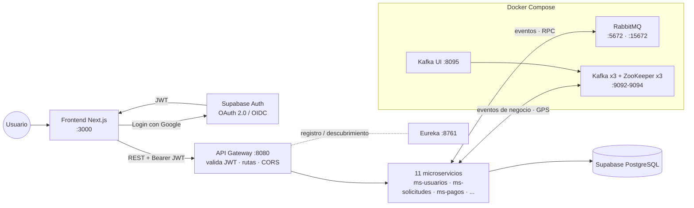
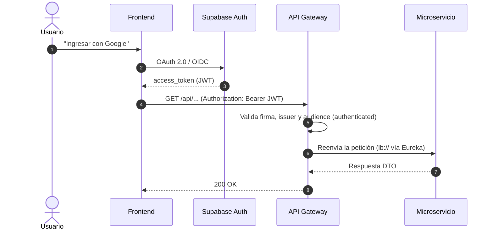
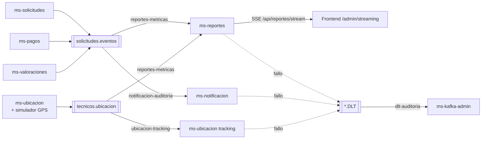

# 🛠️ HomeFixer — Plataforma Cloud Native de servicios para el hogar


HomeFixer conecta a clientes que necesitan reparaciones u obras en el hogar con técnicos especializados. Está construida con una **arquitectura de microservicios cloud-native**: un API Gateway, descubrimiento de servicios con Eureka, mensajería con RabbitMQ y streaming de eventos con Apache Kafka.

**Asignatura:** DSY1107 — Desarrollo Cloud Native · Duoc UC

## 👥 Integrantes

| Nombre | RUT |
|---|---|
| Brayan Oyarce | 19.778.809-7 |
| Dante Rojas | 18.698.772-1 |
| Cristofer Lobos | 19.343.166-6 |

---

## 🎯 Objetivos

- Permitir que un cliente cree una solicitud de servicio y que se le asigne un técnico cercano y con la especialidad adecuada.
- Cubrir el ciclo completo del servicio: solicitud, asignación, llegada, ejecución, cobro, pago y valoración.
- Desacoplar los microservicios mediante mensajería asíncrona confiable (RabbitMQ).
- Procesar los eventos de negocio como un stream (Kafka) para tener métricas en tiempo real, auditoría y tracking de técnicos.
- Autenticar con Google (OAuth 2.0 / OIDC) usando Supabase como proveedor de identidad.

---

## 🚀 Tecnologías

| Capa | Tecnología |
|---|---|
| Frontend | Next.js 16 · React 19 · Tailwind CSS 4 (`fronend-home/`) |
| Backend | Java 17 · Spring Boot 3.2 · Spring Cloud 2023.0 (Gateway, Eureka, OpenFeign) · Maven multimódulo |
| Identidad | Supabase Auth (OAuth 2.0 / OIDC con Google); el Gateway valida el JWT con `issuer-uri` (Nimbus) |
| Persistencia | Spring Data JPA sobre **Supabase PostgreSQL** (base gestionada en la nube) |
| Mensajería | RabbitMQ 3.13 en Docker (eventos, RPC, ACK manual, DLQ, clúster de 2 nodos) |
| Streaming | Apache Kafka en Docker (3 ZooKeeper + 3 brokers, RF 3) · Kafka UI |
| Documentación API | SpringDoc OpenAPI 3 (Swagger UI) |

---

## 🏗 Arquitectura

El proyecto se ejecuta de forma local. Los servicios gestionados en la nube son **Supabase Auth** y **Supabase PostgreSQL**. RabbitMQ y Kafka corren en contenedores con **Docker Compose**.



**¿Por qué esta arquitectura?**
- **API Gateway** como único punto de entrada: centraliza la seguridad (JWT), CORS y el ruteo con balanceo (`lb://`).
- **Eureka + OpenFeign:** los servicios se encuentran por nombre, sin IPs fijas.
- **Supabase:** delega la autenticación con Google y la base de datos a un servicio gestionado, sin credenciales en el código.
- **RabbitMQ** para el workflow transaccional (cobro, pago, reputación) y **Kafka** para el stream de eventos que se retiene y se puede releer (métricas, auditoría, tracking).
- **Docker Compose:** la infraestructura de mensajería se levanta igual en cualquier equipo.

---

## 📦 Módulos y microservicios

| Módulo | Puerto | Descripción | Rutas en el Gateway |
|---|:-:|---|---|
| `eureka-server` | 8761 | Service registry | — |
| `api-gateway` | 8080 | Punto de entrada único: valida el JWT de Supabase, CORS y ruteo | — |
| `ms-usuarios` | 8081 | Perfiles (Usuario → Cliente / Técnico), reputación y estados | `/api/usuarios/**`, `/api/clientes/**`, `/api/tecnicos/**` |
| `ms-solicitudes` | 8082 | Core de negocio: solicitudes, asignación, estados y chat. Servidor RPC | `/api/solicitudes/**`, `/api/chat/**` |
| `ms-autenticacion` | 8083 | Sincroniza el usuario autenticado en Supabase con la plataforma (`POST /api/auth/sync`) | `/api/auth/**` |
| `ms-maestria` | 8084 | Categorías, especialidades, certificaciones e insignias | `/api/maestria/**`, `/api/categorias/**` |
| `ms-ubicacion` | 8085 | Geolocalización, técnicos cercanos, tracking GPS (productor Kafka) | `/api/ubicacion/**` |
| `ms-notificacion` | 8086 | Notificaciones a usuarios y auditoría de eventos | `/api/notificaciones/**`, `/api/admin/**` |
| `ms-pagos` | 8087 | Cobros y pagos | `/api/pagos/**` |
| `ms-valoraciones` | 8088 | Reseñas y calificaciones | `/api/valoraciones/**` |
| `ms-promociones` | 8089 | Descuentos, cupones y membresías | `/api/promociones/**` |
| `ms-reportes` | 8090 | Dashboard y métricas en tiempo real desde Kafka (SSE) | `/api/reportes/**` |
| `ms-kafka-admin` | 8091 | Administración de Kafka: tópicos, consumer groups, lag, offsets, DLT y generador de carga | `/api/kafka/**` |
| `shared` | — | Librería común: DTOs, enums, topología RabbitMQ y publicador Kafka | — |

---

## 🔐 Manejo de APIs y autenticación



- **Síncrono HTTP:** OpenFeign entre servicios. Por ejemplo, ms-solicitudes llama a ms-ubicacion (técnicos cercanos) y a ms-usuarios (especialidad del técnico).
- **Síncrono por mensajería (RPC):** exchange `homefixer.rpc` con `reply_to` y `correlation_id`, timeout de 5 s y respuesta 503 si no llega.
- **Swagger UI:** `http://localhost:<PUERTO>/swagger-ui/index.html` en cada servicio. El Gateway también agrupa las docs de todos los servicios en `/v3/api-docs/<servicio>`.

---

## 🐇 Mensajería con RabbitMQ

La topología está en `shared/.../messaging` (`MessagingConstants`, `EventQueues`, `EventPublisher`).

| Exchange | Tipo | Uso |
|---|---|---|
| `homefixer.events` | topic | Eventos de negocio (pub/sub) |
| `homefixer.rpc` | direct | Request/Reply hacia ms-solicitudes |
| `homefixer.dlx` | direct | Dead Letter Exchange → una `*.dlq` por cola |

| Evento | Productor | Consumidores |
|---|---|---|
| `solicitud.creada` / `solicitud.tecnico-asignado` | ms-solicitudes | notificación, reportes |
| `solicitud.estado-actualizado` | ms-solicitudes | notificación, reportes, **pagos** (genera el cobro) |
| `pago.procesado` | ms-pagos | notificación, **solicitudes** (COMPLETADA → PAGADA) |
| `valoracion.registrada` | ms-valoraciones | notificación, **usuarios** (recalcula la reputación) |
| `certificacion.aprobada` / `rechazada` | ms-maestria | notificación |
| `chat.mensaje` | ms-solicitudes | notificación |

**Confiabilidad**
- Publisher confirms (`correlated`) y returns: el broker confirma cada mensaje y avisa de los que no se pueden enrutar.
- ACK manual en los consumidores (`prefetch: 10`); los rechazos no vuelven a la cola y van a la DLQ. ms-notificacion reintenta 3 veces antes de rechazar.
- Colas y mensajes durables, TTL de 24 h y largo máximo de 10.000 mensajes por cola.
- Consumidores idempotentes por `eventoId`.
- Clúster de 2 nodos opcional en `docker-compose.cluster.yml` (`rabbitmq1` :15672 y `rabbitmq2` :15673).

---

## 📡 Streaming con Apache Kafka

Kafka **complementa** a RabbitMQ: cada hecho de negocio también se publica como evento en Kafka, donde queda retenido y se puede releer. Si Kafka cae, el negocio sigue funcionando por RabbitMQ (con `KAFKA_ENABLED=false` un servicio deja de usar Kafka).

**Clúster (`docker-compose.kafka.yml`):** 3 ZooKeeper en quórum, 3 brokers, `acks=all`, `min.insync.replicas=2` y `unclean.leader.election.enable=false`. El clúster tolera la caída de un broker sin perder datos.

| Tópico | Part. | RF | Key | Retención |
|---|:-:|:-:|---|---|
| `homefixer.solicitudes.eventos` | 3 | 3 | `solicitudId` | 7 días |
| `homefixer.tecnicos.ubicacion` | 3 | 3 | `tecnicoId` | 24 h, compactado |
| `*.DLT` | 3 | 3 | — | 14 días |

Los tópicos se crean con `kafka/create-topics.sh` (contenedor `kafka-init`).



- **Productor:** `acks=all`, idempotente y con compresión `lz4`. La key mantiene el orden por solicitud o por técnico.
- **Consumidores:** commit manual del offset después de procesar, `concurrency: 3` (un hilo por partición) y DLT para los mensajes que fallan.
- **Métricas en tiempo real:** solicitudes por estado y categoría, ingresos, calificaciones y técnicos en línea, vía `GET /api/reportes/metricas/tiempo-real` y SSE en `/api/reportes/stream`.
- **Supervisión:** Kafka UI en `http://localhost:8095` y `ms-kafka-admin` (lag por consumer group, reset de offsets, DLT, `POST /api/kafka/admin/simular?eventos=N` para la demo de carga).

---

## 🛠️ Cómo ejecutar (local)

**Requisitos:** Java 17, Node.js, Docker Desktop y un proyecto de Supabase con el proveedor Google habilitado.

1. **Variables de entorno.** Crea un `.env` en la raíz (no se sube al repositorio) con:
   `SUPABASE_DB_URL`, `SUPABASE_DB_USER`, `SUPABASE_DB_PASSWORD`, `SUPABASE_JWT_ISSUER`, `SUPABASE_JWT_AUDIENCE`, `SUPABASE_JWT_SECRET`, `SUPABASE_SERVICE_ROLE_KEY` y `ADMIN_EMAILS`.
   El frontend usa `fronend-home/.env` con `NEXT_PUBLIC_API_URL`, `NEXT_PUBLIC_SUPABASE_URL` y `NEXT_PUBLIC_SUPABASE_ANON_KEY`.
2. **Infraestructura en Docker:**
   ```bash
   docker compose up -d                                  # RabbitMQ → http://localhost:15672 (guest/guest)
   docker compose -f docker-compose.kafka.yml up -d      # 3 ZooKeeper + 3 brokers + tópicos
   docker compose -f docker-compose.kafka-ui.yml up -d   # Kafka UI → http://localhost:8095
   ```
3. **Compilar el backend:**
   ```bash
   ./mvnw clean install -DskipTests
   ```
4. **Levantar los microservicios.** `start-all.ps1` carga el `.env` y arranca Eureka, el Gateway y los 11 microservicios en orden. `stop-all.ps1` los detiene.
   ```powershell
   .\start-all.ps1
   ```
5. **Levantar el frontend:**
   ```bash
   cd fronend-home
   npm install
   npm run dev        # http://localhost:3000
   ```

| Consola | URL |
|---|---|
| Frontend | http://localhost:3000 |
| Eureka | http://localhost:8761 |
| API Gateway | http://localhost:8080 |
| RabbitMQ Management | http://localhost:15672 |
| Kafka UI | http://localhost:8095 |

---

## 🧩 Patrones de diseño

- **API Gateway + Service Registry** (Spring Cloud Gateway + Eureka).
- **DTO** en todas las respuestas; las entidades JPA no se exponen.
- **Service Layer** y manejo global de errores con `@ControllerAdvice`.
- **Event-driven:** publish/subscribe, request/reply, dead letter y consumidores idempotentes.
- **12-Factor:** sin credenciales en el código; todo se configura por variables de entorno.

---

## 📁 Entregables

1. Presentación del sistema (PPT, máximo 15 diapositivas).
2. Video de evidencia del front y el back (máximo 5 minutos).
3. Código fuente: este repositorio.

---
*HomeFixer — Duoc UC, DSY1107 Desarrollo Cloud Native.*
